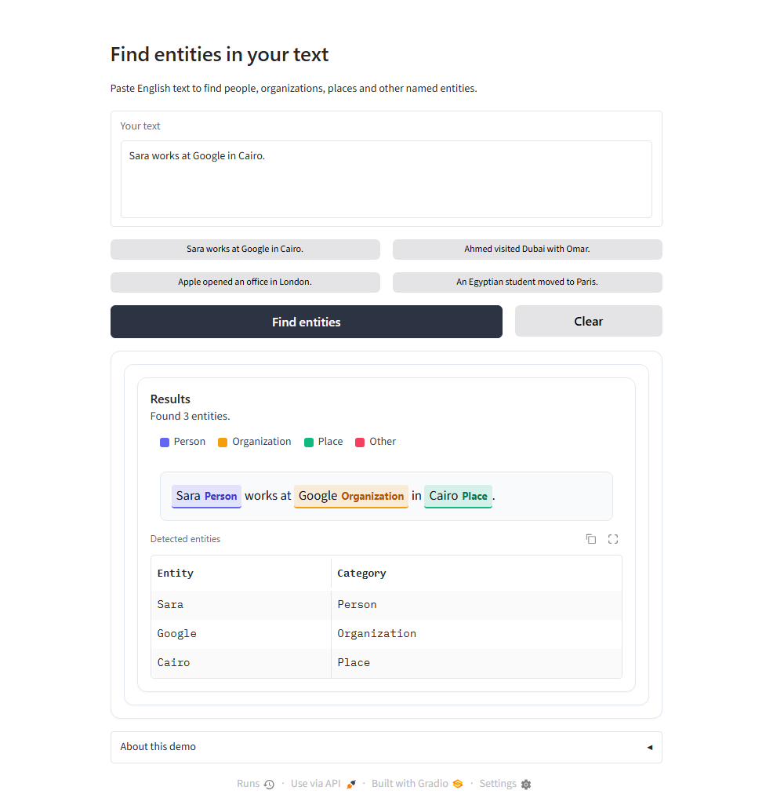

# Named Entity Recognition System

[](https://github.com/Solayman-Sameh/named-entity-recognition/actions/workflows/checks.yml)
[](https://huggingface.co/Solayman-Sameh/named-entity-recognition)

An English NLP project that finds people, organizations, locations and other named entities in text. It compares four sequence-labeling architectures and provides a Gradio application powered by the best validation model, **DistilBERT**.

For example, “Alice works at Microsoft in London” produces **Alice → PER**, **Microsoft → ORG** and **London → LOC**. The app highlights the original text and summarizes each detected entity and its category.

Built for **Instant AI & Data Analysis Training — Sprint 03, Project 02**.



## Explore the project

- [Published Hugging Face model](https://huggingface.co/Solayman-Sameh/named-entity-recognition): fine-tuned DistilBERT weights, tokenizer, and interactive inference widget.
- [GitHub release](https://github.com/Solayman-Sameh/named-entity-recognition/releases/tag/v1.0.0): tagged v1.0.0 release assets and verified notes.
- [Training workflow notebook](notebooks/named_entity_recognition_all_in_one.ipynb): self-contained Kaggle workflow for preparation, 4-model training, evaluation and export.
- [Original executed notebook](notebooks/named_entity_recognition_executed.ipynb): historical execution record with saved outputs.
- [Evaluation report](reports/REPORT.md): full dataset audit, metrics breakdown, and CRF boundary analysis.
- [Demo video](media/demo.mp4): 25-second walkthrough demonstrating the interface.

## Current status

All four models completed training and evaluation in Kaggle using two Tesla T4 GPUs. The selected model achieved **90.18% strict entity-level F1 on the official CoNLL-2003 test set** and is published on [Hugging Face Hub](https://huggingface.co/Solayman-Sameh/named-entity-recognition) under [`Solayman-Sameh/named-entity-recognition`](https://huggingface.co/Solayman-Sameh/named-entity-recognition).

The **10 November 2026 inference update** fixes crashes caused by invisible pasted characters and improves boundaries for acronyms, common titles and hyphenated names. These changes were tested on CPU with the existing trained checkpoint. The historical training results and weights remain unchanged; the revised training notebook has not been rerun end to end in Kaggle.

The demo launches from the project root with **`python app.py`**. On fresh clones, it automatically downloads and verifies the model weights from Hugging Face Hub if they are not already present locally. Public hosting has not been performed; inference runs when the user clicks **Find entities**.

## Models and results

| Model | Representation and approach | Validation F1 | Test F1 |
|---|---|---:|---:|
| LSTM | GloVe + character CNN, forward sequence encoder | 84.72% | 78.63% |
| BiLSTM | Same features, context from both directions | 90.51% | 84.57% |
| BiLSTM + CRF | Bidirectional encoder with learned sequence scoring and Viterbi decoding | 91.62% | 86.48% |
| **DistilBERT** | Fine-tuned `distilbert/distilbert-base-cased` with Hugging Face Trainer | **93.92%** | **90.18%** |

Scores measure exact entity boundaries **and** entity type using seqeval in strict IOB2 mode. They are not token accuracy. The winner was selected using validation performance before final test inference.

On the test set, adding CRF improved BiLSTM F1 by **1.91 percentage points**. It corrected 190 entity boundaries and worsened 78; invalid BIO transitions fell from 226 to 7. The CRF is unconstrained, so it does not guarantee valid BIO sequences. Results come from one seed and one configuration per architecture.

DistilBERT's test F1 by entity type is **PER 95.18%**, **ORG 87.77%**, **LOC 92.37%** and **MISC 79.49%**.

## Dataset and preparation

The project uses **CoNLL-2003 English**, an annotated newswire corpus, through a pinned [Parquet mirror](https://huggingface.co/datasets/BramVanroy/conll2003) of the [assignment-linked dataset](https://huggingface.co/datasets/eriktks/conll2003).

| Split | Sentences | Words | Purpose |
|---|---:|---:|---|
| Training | 14,041 | 203,621 | Learn model parameters |
| Validation | 3,250 | 51,362 | Select checkpoints and the final model |
| Test | 3,453 | 46,435 | Final held-out evaluation |

- Labels are **PER**, **ORG**, **LOC** and **MISC**, using `B-` for an entity's first word, `I-` for continuation and `O` for other words. There is no separate DATE label.
- Original casing, punctuation and official split boundaries are retained. Word and character vocabularies use training data only; POS/chunk annotations are not model inputs.
- Recurrent models combine pretrained **50-dimensional GloVe** vectors with learned character features for unfamiliar words. DistilBERT handles words through subwords, with labels aligned to the first subword.
- All benchmark sentences fit within 256 subwords. Longer app inputs use whole-word chunks and reconstruct predictions without dropping the tail.
- The audit records hashes, revisions, vocabulary coverage and duplicate sentences. There are 78 distinct sentence keys shared by training and test in the official corpus; this is disclosed rather than silently changing the benchmark.

## Project structure

This tree shows the shareable files after applying `.gitignore`. Local model archives, delivery backups, audit evidence and generated caches are excluded.

```text
Project02-Named_Entity_Recognition_System/
├── .gitattributes  # Line endings and Git attribute rules
├── .github/  # GitHub configuration and automated workflows
│   └── workflows/  # Continuous integration workflows
│       └── checks.yml  # Offline checks and verified tagged releases
├── .gitignore  # Excludes weights, caches, secrets and drafts
├── LICENSE  # MIT license
├── README.md  # Overview, results, usage, and links
├── app.py  # Root demo launcher
├── docs/  # Planning, verification and release notes
│   ├── Cloud_Work_Prompt.md  # Kaggle GPU training handoff prompt
│   ├── Demo_Setup_2026-11-10.json  # Demo bundle checksum manifest
│   ├── Inference_Update_2026-11-10.json  # Raw-text tokenizer and edge-case fixes
│   ├── Project_Proposal.md  # Original project proposal and architecture plan
│   ├── Release_Readiness_2026-11-10.json  # Audit checklist and verification record
│   ├── Release_Readiness_2026-11-11.json  # Final release readiness checklist
│   ├── UI_Update_2026-11-10.json  # Gradio interface and styling adjustments
│   └── releases/  # Versioned release notes
│       └── v1.0.0.md  # v1.0.0 release notes
├── media/  # App preview and finished demo video
│   ├── README.md  # Media assets overview and notes
│   ├── app-preview.png  # Interface preview screenshot
│   └── demo.mp4  # Finished 25-second demo video
├── notebooks/  # Current training workflow and original executed run
│   ├── named_entity_recognition_all_in_one.ipynb  # Self-contained Kaggle training workflow
│   └── named_entity_recognition_executed.ipynb  # Historical executed training record with outputs
├── prepare_demo.py  # Model preparation and auto-download
├── reports/  # Small results and figures
│   ├── REPORT.md  # Model evaluation and comparison report
│   ├── comparison.json  # Strict seqeval F1 metrics for all models
│   ├── crf_test_comparison.json  # BiLSTM vs BiLSTM-CRF boundary transition diffs
│   ├── eda.png  # Entity distribution exploratory analysis chart
│   └── learning_curves.png  # Loss and validation F1 curves across epochs
├── requirements-ci.txt  # Lightweight automated-check dependency
├── requirements-demo.txt  # Local demo dependencies
├── scripts/  # Repository maintenance tools
│   ├── check_repository.py  # Model-free integrity and syntax validator
│   ├── download_model.py  # Hugging Face weights downloader and validator
│   └── update_readme_tree.py  # Single README tree generator
├── src/  # Training pipeline and inference implementation
│   ├── app.py  # Gradio application definition and styling
│   ├── bootstrap.py  # Kaggle environment setup and dependencies
│   ├── common.py  # IOB conversion, seqeval metrics and chunking helpers
│   ├── finalize.py  # Metric recalculation, artifacts bundle and export
│   ├── inference.py  # Offline CPU inference engine and span extractor
│   ├── models.py  # PyTorch LSTM, BiLSTM, BiLSTM-CRF and DistilBERT architectures
│   ├── pipeline.py  # Orchestration for dataset, training, evaluation and export
│   ├── prepare.py  # CoNLL-2003 download, GloVe extraction and vocabulary build
│   ├── reference.json  # Baseline metrics and reproducibility fingerprints
│   ├── requirements.txt  # Pinned Kaggle GPU training dependencies
│   ├── scheduler.py  # Multi-GPU / single-GPU training job scheduler
│   ├── source_lock.json  # Pinned external dataset and model URLs
│   ├── verify.py  # Post-training checkpoint and prediction auditor
│   └── worker.py  # Subprocess runner for isolated model training jobs
└── tests/  # Regression tests
    └── test_text_inference.py  # Regression tests for tokenization, offsets and boundaries
```

The proposal and cloud handoff in `docs/` describe the original planning stage. This README is the current project status. The `review/` folder is a local historical audit; its original findings predate the inference fixes.

## Run training in Kaggle

1. Import `notebooks/named_entity_recognition_all_in_one.ipynb` into Kaggle.
2. Enable **Internet** and select **GPU T4 ×2**. One GPU is also supported by the scheduler.
3. Choose **Save Version → Save & Run All**.
4. Retain the generated outputs before ending the session.

The notebook embeds the runtime source and downloads the pinned dataset, GloVe resource and pretrained transformer inside Kaggle. No prepared dataset or source-folder upload is required. The isolated dependency setup preserves the host's compatible CUDA PyTorch installation.

Full mode runs preparation, bounded checks, a tiny training preflight, all four training jobs, validation-based selection, final test evaluation and export. Optional `smoke` mode uses 32 training and 16 validation sentences without test evaluation; `prep` audits the dataset without training. A full CPU-only run stops after preflight and requests a GPU.

The updated notebook uses a new `ner_raw_v2_` run name because source changes invalidate the old experiment identity. Same-session reruns can reuse compatible completed models after hash checks. Interrupted optimization restarts; optimizer-state resume is not implemented.

## Run the trained application

On this machine, the model is already prepared. Open Anaconda PowerShell Prompt and run:

```powershell
conda activate main
cd "C:\Users\user\Documents\Antigravity\Instant_training\Sprint03-NLP\Project02-Named_Entity_Recognition_System"
python app.py
```

Open **http://127.0.0.1:7860**, enter English text and click **Find entities**. Press **Ctrl+C** in the terminal to stop the server. Root `app.py` is the entry point; `src/app.py` defines the Gradio interface.

The root launcher uses `artifacts/selected_model/`. If those local files are missing, `prepare_demo.py` automatically downloads and verifies the model weights from Hugging Face Hub ([`Solayman-Sameh/named-entity-recognition`](https://huggingface.co/Solayman-Sameh/named-entity-recognition)). Alternatively, if the saved `codex-space/ner_gradio_app.zip` archive is present, it extracts from the local archive.

To download the model weights explicitly beforehand:

```powershell
python scripts/download_model.py
```

For a fresh checkout, install the demo dependencies once and launch the app:

```powershell
python -m pip install -r requirements-demo.txt
python app.py
```

`requirements-demo.txt` describes the local demo stack; `src/requirements.txt` preserves the original Kaggle training stack. Do not install the full training requirements just to run this demo. Model/tokenizer loading is local-only after setup; the app does not fetch the training corpus or GloVe vectors.

## Use the published model directly

The fine-tuned DistilBERT model can also be used directly in Python with Hugging Face Transformers:

```python
from transformers import pipeline

ner = pipeline(
    "ner",
    model="Solayman-Sameh/named-entity-recognition",
    aggregation_strategy="simple",
)

text = "Sara works at Google in Cairo."
entities = ner(text)
for ent in entities:
    print(f"{ent['word']} -> {ent['entity_group']} ({ent['score']:.4f})")
```

The interface includes a text box, four familiar example buttons, **Find entities** and **Clear** actions, and a results card. Colors and full category names identify people, organizations, places and other entities. The Entity/Category table appears when entities are found and stays hidden for blank or no-result inputs. A collapsed **About this demo** section explains the scope. Character positions and CPU timing stay out of the screen. The limit is 20,000 characters.

The raw-v2 tokenizer keeps acronyms such as `U.S.`, common titles such as `Dr.`, and hyphenated words such as `Jean-Claude` together. Invisible format/control characters are omitted from the inference view while the displayed input and original offsets remain intact. Standalone marks that the transformer normalizes to nothing are skipped during raw-text inference. Benchmark word-token input is unchanged.

## Saved outputs

| Archive | Contents |
|---|---|
| `ner_reports.zip` | Dataset audit, metrics, plots, error examples and CRF comparisons |
| `ner_all_checkpoints.zip` | Four best checkpoints, original training source, configuration, reports and logs |
| `ner_gradio_app.zip` | Selected trained model, tokenizer, updated inference code and Gradio app |

`archive_manifest.json` records archive sizes and SHA-256 checksums. The original all-checkpoint and reports archives retain the historical training experiment. The app archive carries a separate inference-update record; changing app text processing does not alter the historical scores.

## Verification and limitations

The final audit independently recalculated all saved validation/test entity metrics and reproduced every saved test prediction for all four models on CPU. One DistilBERT validation token differed across runtimes, changing F1 by about 0.008 percentage points. Archive integrity and checkpoint manifests passed.

The root launcher and all six regression checks were also verified in the existing `main` environment using PyTorch 2.5.1, Transformers 5.13.0, Hugging Face Hub 1.16.0 and Gradio 6.30.0. The latest UI was also checked with six live result/empty requests and its Clear action. The app bundle and current training notebook contain the same current UI source; the original executed notebook remains the historical training record.

The inference update has regression tests for invisible characters, joined emoji, source offsets, abbreviations, hyphenated names, blank input, the length limit and long-input coverage. Run the lightweight tests from the project folder:

```bash
python -m unittest discover -s tests -v
```

Checkpoint tests are skipped unless `NER_MODEL_DIR` points to the prepared `artifacts/selected_model` folder and the model dependencies are installed. For example, in PowerShell:

```powershell
$env:NER_MODEL_DIR = (Resolve-Path '.\artifacts\selected_model').Path
python -m unittest discover -s tests -v
```

The system is an English newswire model and can miss entities or assign the wrong type, especially MISC. Raw-text tokenization remains heuristic and is not identical to the corpus's human tokenization. It does not provide multilingual, nested-entity or date extraction, calibrated confidence, automatic updates while typing, or a public hosting URL. Training results are benchmark measurements, not a guarantee for arbitrary text.

## Demo video and Git

The [demo video](media/demo.mp4) is included at **`media/demo.mp4`** (about 1.56 MB) alongside the [interface screenshot](media/app-preview.png); see [the media notes](media/README.md). Raw recordings and editing drafts belong in `media/raw/` or `media/drafts/`, which are ignored by `.gitignore`.

Source code, notebooks, small result reports and figures, documentation, tests and the final demo video belong in Git. Model weights, local archives, runtime caches, secrets and raw recordings do not. The `reports/` folder contains lightweight results that readers can inspect without downloading checkpoints. No model weights are required to view the results or video.

## License and external resources

The project's original source code is available under the [MIT License](LICENSE), copyright 2026 Solayman-Sameh. The standard license text is published by the [Open Source Initiative](https://opensource.org/license/mit).

This project license does not replace the terms of CoNLL-2003, pretrained GloVe vectors, DistilBERT or third-party libraries. Source URLs and resolved revisions are recorded in `src/source_lock.json`; consult the linked resource terms before redistributing those assets. Large dataset and model files are excluded from Git.

## Automated checks and releases

GitHub Actions runs lightweight checks on pushes, pull requests and manual runs, using Python 3.11 and 3.12. It validates Python syntax, JSON, notebook structure, notebook/source consistency, required release files, local documentation links and the single README tree. It also runs the model-free text/offset regressions. Model-dependent tests remain optional local checks.

CI installs only the small notebook-validation dependency; it does not download models or datasets, run inference, execute notebook cells, train anything, or use your Hugging Face credentials. To run the same checks locally:

```powershell
python -m pip install -r requirements-ci.txt
python scripts/update_readme_tree.py
python scripts/check_repository.py
python -m unittest discover -s tests -v
```

When files are added or removed, refresh the tree with `scripts/update_readme_tree.py` before committing. A version tag such as `v1.0.0` triggers the same checks; after both Python jobs pass, the workflow publishes the GitHub release using the matching notes in `docs/releases/`. See the [v1.0.0 release notes](docs/releases/v1.0.0.md).

Repository: [Solayman-Sameh/named-entity-recognition](https://github.com/Solayman-Sameh/named-entity-recognition). Model: [Hugging Face Model Hub](https://huggingface.co/Solayman-Sameh/named-entity-recognition). App hosting is intentionally omitted.
